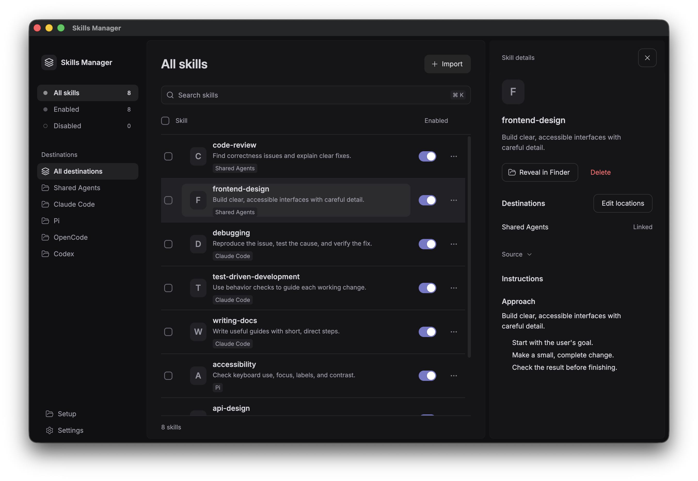
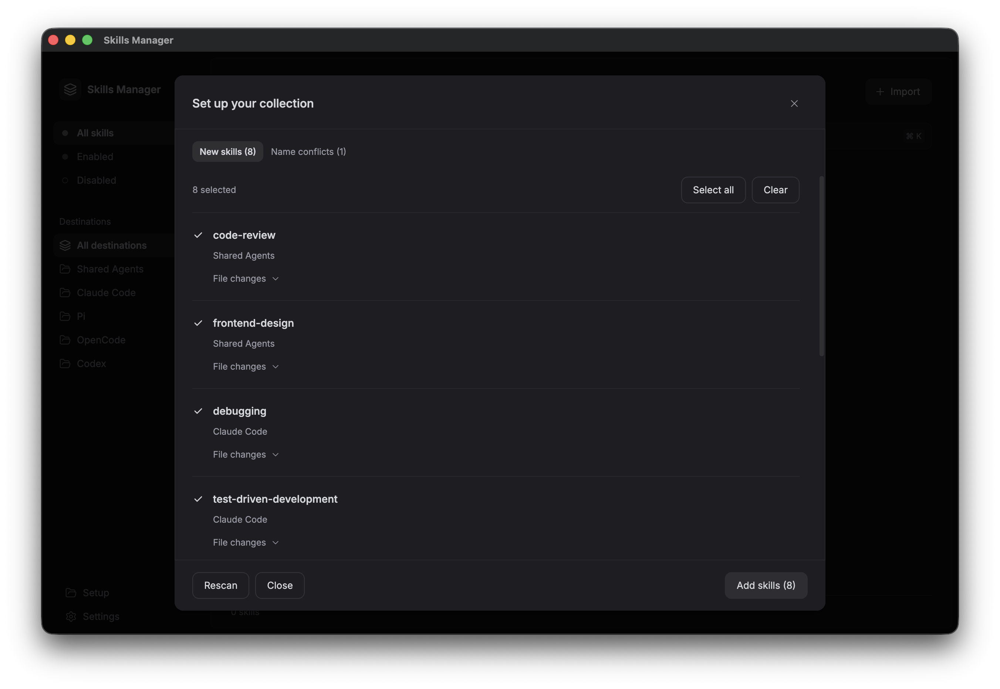
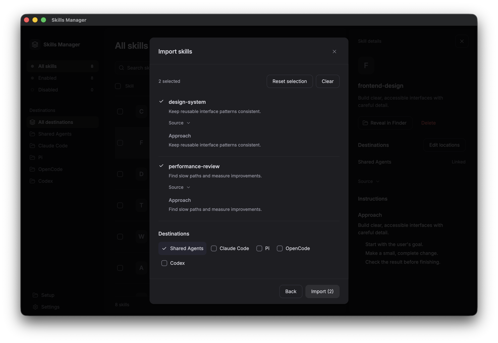

# Skills Manager

**Find, add, and manage your AI coding skills in one Mac app.**

Skills are folders of instructions and supporting files that coding assistants use for tasks such as reviewing code or writing docs. Skills Manager works with **Claude Code, Codex, Pi, and OpenCode**.

Keep one shared copy of a skill. Edit its files once, and every tool linked to it sees the change. Search one list, turn skills on or off, and change many at once.

[Download for Mac — Apple Silicon](https://github.com/seb-lewis/skills-manager/releases/tag/v0.1.0)

## What you can do

- **Find what is installed.** See skills across your coding tools in one searchable list.
- **Bring your skills with you.** Import existing skill folders or add skills from GitHub and skills.sh.
- **Control your collection.** Enable, disable, or delete skills individually or in bulk. Disabling keeps the skill's files.
- **Keep your current setup.** Skills stay linked in the folders where they were found. Add links to other locations only when you choose them.
- **Leave when you want.** Undo setup to put normal skill folders back before removing the app.

## Install

1. [Download the Mac app](https://github.com/seb-lewis/skills-manager/releases/tag/v0.1.0) and unzip it.
2. Move **Skills Manager.app** to **Applications**.
3. Open the app.

This early preview is for **Apple Silicon Macs**. It is not signed with an Apple Developer ID or notarized, so macOS may block it. If you choose to open it, follow [Apple's instructions](https://support.apple.com/en-us/102445).

## Start with the skills you already have

Choose **Review existing skills**. The app finds existing skills, groups identical copies, and lets you resolve name conflicts before applying setup. Open **File changes** to see what will change.

Setup copies each skill to `~/.skills-manager/skills/` and verifies the copy. It then replaces the original folder with a file-system link—a shortcut to the stored copy. Your coding tools still find the skill at the same location.

## Add new skills

Choose **Import**, then select a local folder or paste a GitHub repository, skills.sh link, or supported `skills add` command. Select the skills you want, choose their locations, and import them.

For a new local source, Import copies the files and leaves that source folder unchanged. Skills already installed in a coding tool go through the setup review.

Some tools read the same folders. For example, [OpenCode also searches `~/.claude/skills`](https://opencode.ai/docs/skills/#discovery). You do not need to add another link just for OpenCode.

## Undo setup or remove the app

Open **Settings → Undo setup** to review the locations that will be restored, then choose **Restore skills**. Skills restored to these locations become available again, even if you had disabled them. Missing or conflicting locations are left unchanged; their skills are still included in the export.

Undo also saves the full collection in a `Skills Manager Export-…` folder in your home folder. The review shows its exact path before you start.

Once Undo completes and you have checked your saved skills, move the app to the Trash. Removing only the app leaves the managed files and links in place.

## More information

- [Preview limits and release notes](docs/RELEASE.md)
- [Build from source](docs/DEVELOPMENT.md)
- [Report a problem](https://github.com/seb-lewis/skills-manager/issues)
- [MIT license](LICENSE) · [Third-party notices](docs/THIRD_PARTY_NOTICES.md)
